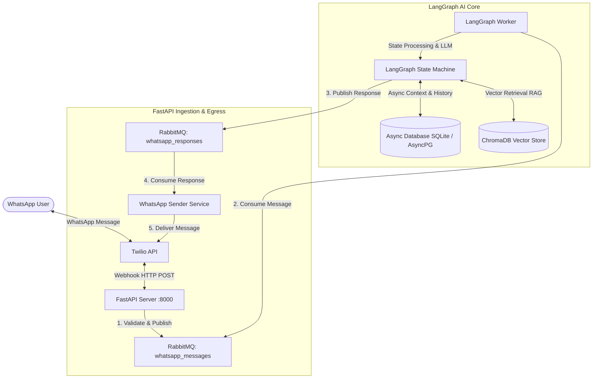

# RevSprint WhatsApp AI Agent System 🚀

An event-driven, production-grade WhatsApp AI agent system built with **FastAPI**, **LangGraph**, **RabbitMQ**, **ChromaDB**, **Twilio**, and **Google Gemini (2.5)**.

---

## 📑 Table of Contents
- [Overview](#overview)
- [Architecture & Design Highlights](#architecture--design-highlights)
  - [System Flow](#system-flow)
  - [Key Technical Features](#key-technical-features)
- [Quickstart Guide (For Beginners)](#quickstart-guide-for-beginners)
  - [Prerequisites](#prerequisites)
  - [Option A: Docker Setup (Recommended / One-Click)](#option-a-docker-setup-recommended--one-click)
  - [Option B: Local Development Setup](#option-b-local-development-setup)
- [Environment Configuration](#environment-configuration)
- [Deep Dive Architecture (For Senior Engineers)](#deep-dive-architecture-for-senior-engineers)
  - [Dead-Letter Exchange (DLX) & Retry Pattern](#dead-letter-exchange-dlx--retry-pattern)
  - [LangGraph Agentic State Graph](#langgraph-agentic-state-graph)
  - [Async Persistence & Vector RAG Store](#async-persistence--vector-rag-store)
- [API Documentation & Endpoints](#api-documentation--endpoints)
- [Project Directory Structure](#project-directory-structure)
- [Troubleshooting](#troubleshooting)
- [License](#license)

---

## Overview

**RevSprint** is an asynchronous, decoupled, multi-component conversational AI platform. It receives incoming WhatsApp messages via Twilio webhooks, buffers and decouples them via RabbitMQ message queues, processes them with a LangGraph state machine powered by Google Gemini, stores conversational context in SQLite/PostgreSQL, and dispatches responses back through WhatsApp asynchronously.

Whether you are setting up the project for the first time or evaluating its architectural patterns, this guide covers both step-by-step setup and deep technical internals.

---

## Architecture & Design Highlights

### System Flow



### Key Technical Features

- **Decoupled Asynchronous Processing**: FastAPI ingests incoming webhooks instantaneously (< 50ms) and offloads processing to RabbitMQ.
- **Resilient Queue Design with Dead Letter Queues (DLQ)**: Failed message executions are automatically routed through retry queues with backoff exponential delays before hitting parking lot queues.
- **Stateful AI Agents with LangGraph**: Contextual agent workflows with modular intent classification, semantic memory retrieval (ChromaDB), and structured response generation.
- **Dual API Documentation**: Standard Swagger UI alongside interactive **Scalar API** reference (`/scalar`).
- **Supervisord Multi-Process Containerization**: Dockerized setup running RabbitMQ, FastAPI, and LangGraph under Supervisord in a unified runtime.

---

## Quickstart Guide (For Beginners)

Follow these steps to get the system running locally in under 5 minutes.

### Prerequisites

Make sure you have installed on your system:
- [Docker & Docker Compose](https://www.docker.com/get-started/) (Recommended for easy setup)
- *OR* Python 3.12+ and [Poetry](https://python-poetry.org/docs/#installation) / RabbitMQ for manual local setup.
- A **Google Gemini API Key** (Get one at [Google AI Studio](https://aistudio.google.com/)).
- A **Twilio Sandbox / Account** with WhatsApp capability.

---

### Option A: Docker Setup (Recommended / One-Click)

1. **Clone the repository:**
   ```bash
   git clone <repository-url>
   cd revsprint
   ```

2. **Configure Environment Variables:**
   Copy `.env_example` to `.env`:
   ```bash
   cp .env_example .env
   ```
   Open `.env` in any text editor and fill in your API credentials:
   ```env
   GOOGLE_API_KEY=your_gemini_api_key_here
   TWILIO_ACCOUNT_SID=your_twilio_sid
   TWILIO_AUTH_TOKEN=your_twilio_auth_token
   TWILIO_PHONE_NUMBER=whatsapp:+14155238886
   WHATSAPP_VERIFY_TOKEN=your_custom_webhook_secret
   ```

3. **Build and Run with `build.sh` or Docker:**
   ```bash
   chmod +x build.sh
   ./build.sh
   ```
   Or directly with docker:
   ```bash
   docker build -t revsprint-app:latest .
   docker run -p 8000:8000 -p 5672:5672 -p 15672:15672 --env-file .env revsprint-app:latest
   ```

4. **Verify it's running:**
   - **FastAPI API Documentation**: Open [http://localhost:8000/docs](http://localhost:8000/docs) or [http://localhost:8000/scalar](http://localhost:8000/scalar).
   - **RabbitMQ Management Dashboard**: Open [http://localhost:15672](http://localhost:15672) (User: `guest`, Password: `guest`).

---

### Option B: Local Development Setup

If you prefer running services directly on your host machine without Docker:

1. **Install Dependencies via Poetry:**
   ```bash
   poetry install
   ```

2. **Start RabbitMQ Server:**
   Ensure RabbitMQ is running locally on port `5672`.
   ```bash
   # On macOS (Homebrew)
   brew services start rabbitmq
   # On Ubuntu/Debian
   sudo systemctl start rabbitmq-server
   ```

3. **Set Up `.env` File:**
   ```bash
   cp .env_example .env
   # Edit .env with your credentials
   ```

4. **Run FastAPI Server (Terminal 1):**
   ```bash
   poetry run uvicorn app.main:app --reload --port 8000
   ```

5. **Run LangGraph Worker Process (Terminal 2):**
   ```bash
   poetry run python -m langgraph_app.main
   ```

---

## Environment Configuration

Below is a breakdown of key environment variables supported in `.env`:

| Variable | Default Value | Description |
| :--- | :--- | :--- |
| `APP_HOST` | `0.0.0.0` | FastAPI host bind address. |
| `APP_PORT` | `8000` | FastAPI port. |
| `RABBITMQ_HOST` | `localhost` | RabbitMQ broker hostname. |
| `RABBITMQ_PORT` | `5672` | RabbitMQ broker port. |
| `RABBITMQ_USER` | `guest` | RabbitMQ connection username. |
| `RABBITMQ_PASSWORD` | `guest` | RabbitMQ connection password. |
| `WHATSAPP_MESSAGES_QUEUE` | `whatsapp_messages` | Inbound message queue name. |
| `WHATSAPP_RESPONSES_QUEUE` | `whatsapp_responses` | Outbound response queue name. |
| `GOOGLE_API_KEY` | *Required* | API key for Gemini LLM models. |
| `INTENT_MODEL_NAME` | `gemini-2.5-flash-lite-preview-06-17` | Gemini model for intent routing. |
| `RESPONSE_MODEL_NAME` | `gemini-2.5-flash` | Gemini model for response generation. |
| `TWILIO_ACCOUNT_SID` | *Required* | Twilio Account SID. |
| `TWILIO_AUTH_TOKEN` | *Required* | Twilio Auth Token. |
| `TWILIO_PHONE_NUMBER` | *Required* | Twilio WhatsApp sender number (e.g. `whatsapp:+14155238886`). |
| `DATABASE_URL` | `sqlite+aiosqlite:///whatsapp_chat.db` | SQLAlchemy async database connection string. |

---

## Deep Dive Architecture (For Senior Engineers)

### Dead-Letter Exchange (DLX) & Retry Pattern

To prevent loss of user messages due to transient downstream failures (e.g., LLM rate limits, network timeouts, DB connectivity glitches), RevSprint implements an enterprise-grade **Dead Letter Exchange (DLX) retry mechanism**:

```
[Main Queue: whatsapp_messages] ──(Processing Failure)──> [Dead Letter Exchange: requests_dlx]
                                                                  │
[Parking Lot Queue] <──(Exceeded Max Retries)── [Retry Queue: requests_retry_queue]
                                                         │ (TTL Expiration: 5s)
                                                         └──> [Re-published to Main Queue]
```

1. **Main Ingestion Queue**: Consumes incoming payload using manual message acknowledgment (`ack`/`nack`).
2. **DLX & Retry Queue**: When an exception occurs, the consumer `nack`s the message without requeueing. RabbitMQ automatically forwards the message to `requests_dlx`, routing it into `requests_retry_queue`.
3. **TTL Backoff**: Messages in `requests_retry_queue` have a TTL (e.g., 5000ms) and no active consumers. Upon expiration, RabbitMQ automatically dead-letters them back into `whatsapp_messages` for re-processing.
4. **Parking Lot Queue**: After `RABBITMQ_MAX_RETRIES` (default: 3), messages are routed to `requests_parking_lot` for manual inspection and alerting, keeping the primary processing pipeline unblocked.

---

### LangGraph Agentic State Graph

The core conversation logic is built as a stateful graph utilizing **LangGraph**:

```
 [Inbound Event] ──> (Intent Classifier Node)
                           │
             ┌─────────────┴─────────────┐
             ▼                           ▼
  [General / Query Intent]       [Greeting / Statement]
             │                           │
             ▼                           │
  (RAG Retrieval Node)                  │
             │                           │
             └─────────────┬─────────────┘
                           ▼
               (Response Generator Node)
                           │
                           ▼
             (WhatsApp Tool Dispatch Node)
```

- **State Schema**: Tracks message history, user sender ID, current intent, retrieved context docs, generated text, and delivery metadata.
- **Async Execution**: Non-blocking asynchronous nodes using Python `asyncio` for scalable concurrency under heavy load.

---

### Async Persistence & Vector RAG Store

- **Database Layer**: Built on `SQLAlchemy 2.0` with `asyncio` (`aiosqlite` for lightweight environments, seamlessly interchangeable with `asyncpg` for PostgreSQL production deployments).
- **Vector Store**: Uses **ChromaDB** with async wrappers for similarity search on domain knowledge bases to ground agent answers with context.

---

## API Documentation & Endpoints

FastAPI automatically generates interactive documentation accessible when running the application:

- **Interactive Scalar Docs**: `http://localhost:8000/scalar`
- **Swagger UI**: `http://localhost:8000/docs`
- **ReDoc**: `http://localhost:8000/redoc`

### Key Webhook Endpoints

#### 1. Twilio Webhook Receiver
- **`POST /whatsapp/webhook`**
  - Accepts URL-encoded form data pushed by Twilio upon receiving a WhatsApp message.
  - Extracts `From`, `Body`, and metadata, puts message on `whatsapp_messages` queue, and immediately returns HTTP 200 `{"status": "queued"}`.

#### 2. Webhook Verification (Verification / Challenge)
- **`GET /whatsapp/webhook`**
  - Handles Meta / Twilio verification handshake using `WHATSAPP_VERIFY_TOKEN`.

---

## Project Directory Structure

```text
revsprint/
├── app/                        # FastAPI Ingestion & Egress Application
│   ├── internal/               # Internal utilities
│   ├── models/                 # Pydantic schemas & DB ORM models
│   ├── routers/                # FastAPI Webhook endpoints
│   ├── services/               # DB, RabbitMQ, Twilio, VectorStore services
│   ├── config.py               # Pydantic Settings for API server
│   ├── dependencies.py         # FastAPI dependency injection providers
│   └── main.py                 # FastAPI entry point & lifespan manager
├── langgraph_app/              # LangGraph AI Worker Engine
│   ├── models/                 # LangGraph state schemas
│   ├── services/               # LLM, Vector Store & Response Dispatch tools
│   ├── workflows/              # LangGraph workflow nodes & graph definition
│   ├── config.py               # LangGraph worker settings
│   └── main.py                 # LangGraph consumer runner
├── Dockerfile                  # Multi-stage production Docker build
├── supervisord.conf            # Supervisord process manager configuration
├── pyproject.toml              # Poetry dependencies specification
├── requirements.txt            # Pip dependency reference
├── build.sh                    # Helper script to build and run docker image
└── .env_example                # Template for environment configuration
```

---

## Troubleshooting

<details>
<summary><b>1. RabbitMQ connection fails (ConnectionRefusedError)</b></summary>

- Ensure RabbitMQ is running locally or in Docker. Check if port `5672` is open.
- Verify `RABBITMQ_HOST` in `.env` (use `localhost` for local dev, or the container name if running in Docker networking).
</details>

<details>
<summary><b>2. Messages entering Parking Lot Queue</b></summary>

- Inspect `requests_parking_lot` queue in RabbitMQ Management UI (`http://localhost:15672`).
- Common cause: Invalid `GOOGLE_API_KEY` or missing Twilio credentials causing repeated consumer retries.
</details>

<details>
<summary><b>3. Twilio Webhook return HTTP 500 or unreachable</b></summary>

- Use `ngrok` during local testing to expose port 8000 to the public internet:
  ```bash
  ngrok http 8000
  ```
- Configure Twilio Webhook URL in Twilio Console to point to `https://<your-ngrok-subdomain>.ngrok-free.app/whatsapp/webhook`.
</details>

---

## License

This project is open-source under the [MIT License](LICENSE).
